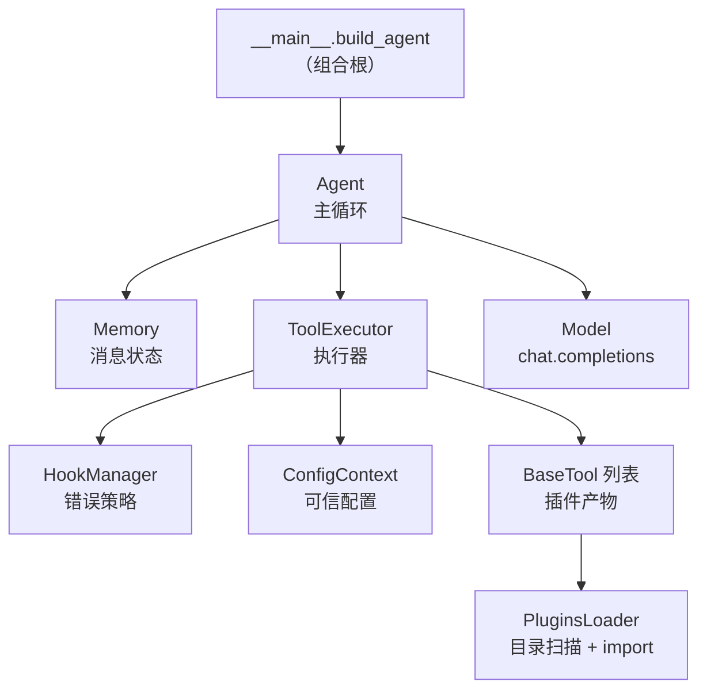

# Scout 架构思想解析

> 这份文档只讲**架构层面的判断**：用了哪些思想、为什么这么用、代价是什么、哪里还没做到。
> 具体坑位记录在 [NOTES.md](NOTES.md)，这里不重复。

---

## 0. 一句话架构

> **一个"模型 ↔ 工具"的循环，所有会变的东西被推到边界（插件目录 / 钩子 / 配置），中间的主循环只依赖协议不依赖实现。**

```
工具定义 → JSON Schema → 插件发现 → 注入装配 → 随请求发给模型
   → 模型返回 tool_calls → 执行 / 出错走钩子 → 结果回填 messages → 再次请求
```

---

## 1. 分层视图



| 层 | 文件 | 单一职责 |
|---|---|---|
| 入口 / 装配 | `src/__main__.py` | 造对象、连线、注入，**不含业务** |
| 主循环 | `src/agent/agent.py` | 调度模型与工具，直到不再调用工具 |
| 执行器 | `src/agent/tool_executor.py` | 查工具、注入参数、执行、重试状态机 |
| 策略 | `src/hooks/hooks.py` | 出错时"回给模型什么话" |
| 消息状态 | `src/memory/memory.py` | messages 列表 + 格式自愈 |
| 契约 | `src/agent/protocol.py`、`src/tool/contract.py`、`src/hooks/hook_contract.py` | 只声明形状 |
| 发现 | `src/tool/plugins_loader.py`、`src/hooks/hook_manager.py` | 扫目录、抓实例 |
| 配置 | `src/config.py`、`src/agent/config_context.py`、`src/deps.py` | 环境 → 对象 |

---

## 2. 思想逐条解析

### 2.1 依赖倒置：用 `Protocol` 而不是抽象基类

**位置**：`src/agent/protocol.py:5-34`

```python
class MemoryProtocol(Protocol):
    messages:list[dict[str,Any]]
    def add_user_msg(self,user_input:str) -> None:...
```

**意图**：主循环只需要"你像个 Memory"，不需要"你是 Memory 的子类"。所以 `Agent.__init__` 的注解是协议而不是具体类（`agent.py:6`），测试里造 `FakeMemory` 不用继承任何东西。

**为什么不用 ABC**：ABC 强制**名义继承**，`class FakeMemory(Memory)` 会把真实实现拖进测试（包括它读 env 的副作用）。`Protocol` 是**结构化类型**——形状对就行。这是 Python 的鸭子类型，用类型标注写了出来。

**代价**：`Protocol` 在运行时**不做任何校验**（除非 `@runtime_checkable` 且只查方法名）。传错对象只会在调用时才炸。它换来的是 IDE 提示和可读性，不是安全性。

> **架构含义**：这是本项目所有可替换性的地基。没有它，后面所有"注入"都无从谈起。

---

### 2.2 组合根（Composition Root）：所有对象只在一个地方被 new

**位置**：`src/__main__.py:32-51` 的 `build_agent()`

```python
memory  = Memory()
hooks   = HookManager(); hooks.register()
executor = ToolExecutor(tools=tool_manager.get_tools(), config=config_context, hooks=hooks)
agent   = Agent(model=get_model(), memory=memory, executor=executor, system=input('设定角色：'))
```

**意图**：除了这里，**没有任何模块 `new` 自己的依赖**。`Agent` 不知道 `Memory` 怎么构造，`ToolExecutor` 不知道钩子从哪来。

**这是判断一个项目有没有架构的最快标准**：能不能在一个函数里看清"整个系统由哪些零件组成"。能，就是组合根；散落在各模块 `__init__` 里各自 `SomeClass()`，就不是。

**代价**：这个函数会随组件增多而变长。**不要**为此抽 `Container` / `ServiceRegistry`——直接读得懂的构造代码，比读得懂的框架便宜得多。

---

### 2.3 构造函数注入 + 按需注入

**位置**：`agent.py:6`、`tool_executor.py:10`

依赖从参数进来，不在内部创建。**但只注入真正用到的**：

| 组件 | 收 `hooks` 吗 | 理由 |
|---|---|---|
| `ToolExecutor` | ✅ | 它是唯一的 `trigger` 调用方 |
| `Memory` | ❌ | 格式自愈是内在不变量，不是策略点 |
| `Agent` | ❌ | 它是编排者，负责**装配**不负责**触发** |

**判据**：如果一个类的 `__init__` 收了某依赖，全文却一次没用，这个参数就是噪声——它会让读者误以为这里有扩展点。

---

### 2.4 声明式注册：装饰器把"定义"变成"对象"

**位置**：`src/tool/basetool_get.py:43-49`、`src/hooks/hook_contract.py:12-15`

```python
@tool(args_schema=ReadFileArgs, max_retry=2)
def read_file(root: str, path: str) -> dict: ...

# 等价于：模块级变量 read_file 其实是一个 BaseTool 实例，不是函数
```

**意图**：写工具的人只关心"函数 + 参数模型 + 重试上限"，不关心 schema 怎么拼、怎么被收集。装饰器在 import 时把函数**包装成契约对象**（`BaseTool` / `Hook`）。

**关键设计**：装饰器**只返回对象，不注册到全局表**。所以：

- 加载 = 扫描模块属性找 `BaseTool` 实例，而不是往某个 module-level dict 里塞
- 副作用为零，重复 import 不会重复注册
- 测试可以单独 import 一个插件文件，不影响别的

> 这是"声明"与"收集"解耦。比"装饰器里直接写进全局注册表"要干净得多。

---

### 2.5 契约作为数据载体：`dataclass` 而非继承

**位置**：`src/tool/contract.py:6-11`、`src/agent/config_context.py:7-10`

```python
@dataclass
class BaseTool:
    func:Callable
    json_schema:dict
    name:str
    max_retry:int
```

**思想**：插件与框架之间传递的是**数据结构**，不是"你实现我的接口方法"。所以加一个字段不影响任何实现方。

**`ConfigContext` 的 `frozen=True`** 是关键：`root` / `tavily_client` 在实例化那一刻固定，运行期不可改。**配置就该是不可变的**——否则你不知道某个工具手里拿的是不是被改过的 root。

---

### 2.6 延迟求值：`field(default_factory=...)`

**位置**：`config_context.py:9-10`

```python
root: str | None = field(default_factory=lambda: get_env('ROOT'))
```

**为什么**：写成 `root = get_env('ROOT')` 会在**类定义时**（import 时）读环境变量，而 `load_dotenv()` 可能还没跑到，值就被写死成 `None`。`default_factory` 延迟到**实例化时**才求值。

**架构含义**：**import 时的副作用**是隐蔽 bug 源。这个项目在 `__main__.py:1-18` 把日志配置排在业务 import 之前，也是同一条原则的另一面。

---

### 2.7 插件化：目录扫描 + 契约类型

**位置**：`src/tool/plugins_loader.py:16-43`

```python
p = Path(__file__).parent / 'plugins'
for file_path in sorted(file_plugin + dir_plugin):
    if file_path.name.startswith('_'):
        continue
    module = importlib.import_module(f'.plugins.{module_name}', package=__package__)
    for name, obj in inspect.getmembers(module):
        if isinstance(obj, BaseTool):
            self.tools.append(obj)
```

**四要素**，缺一不成插件系统：

| 要素 | 本项目做法 |
|---|---|
| 约定位置 | `src/tool/plugins/`（支持单文件 + 带 `__init__.py` 的包） |
| 约定形状 | `isinstance(obj, BaseTool)` |
| 自动发现 | `importlib` + `inspect.getmembers` |
| 隔离失败 | 单个插件炸掉 `continue`，不拖垮整体 |

**`__package__` 当锚点**（`:29`）而不是硬编码 `src.tool.plugins.xxx`：整个包被挪位置时不用改代码。这是**相对的、可重定位的**模块寻址。

**这是本项目最完整的插件化实例**，也是其它层该对标的样板。

---

### 2.8 契约定界：工具是"函数 + schema"，不是"类"

工具插件里写的是**普通函数**，不是类、没有基类、没有 `execute()` 方法。框架需要的三样东西（可调用、名字、参数说明）分别来自：函数本身、`__name__`、pydantic 模型。

**好处**：写一个工具 = 写一个函数 + 一个 `Field(description=...)`。心智负担最低。

**代价**：工具**无法持有状态**。一旦某个工具需要连接池或缓存，就得自己在模块级造对象（`search.py` 就是这么干的，也因此把 import 变成了有副作用的操作——见 NOTES 6.5）。这是设计上已知的取舍，不是疏忽。

---

### 2.9 配置注入 vs 模型传参：一条明确的信任边界

**位置**：`tool_executor.py:42-50`

```python
for name, value in config_items:
    if name in sig.parameters:
        tool_args[name] = value      # 覆盖模型传的同名值
```

| 参数来源 | 可信度 | 处理 |
|---|---|---|
| 模型生成的 `path` / `content` / `query` | **不可信** | 工具内部必须校验（`resolve()` + `is_relative_to`） |
| `ConfigContext` 注入的 `root` | **可信** | 直接覆盖模型传的值 |
| 模型编造的工具名 | **不可信** | 查表失败 → 走 `tool_name_error` 钩子 |

**架构含义**：这是**能力边界**——模型能"建议"参数，但敏感参数（文件系统根、API key）只能由运行时授予。`get_config` 的覆盖语义是刻意的，不是 bug。

---

### 2.10 策略外置：钩子 = 可替换的决策，不是日志

**位置**：`src/hooks/`（`hook_contract.py` + `hook_manager.py` + `hooks.py`）

**设计形态**（当前已达成）：

```python
@hook_register(name='retry_error')
def retry_error(e:Exception, tool_call) -> dict:   # 纯函数：输入 → 决策产物
    ...
```

**三条判据**（决定"该不该做成钩子"）：

| 判据 | 钩子 | 不该是钩子 |
|---|---|---|
| 行为会变吗 | 回传策略、错误分类 | 日志、计数、统计 |
| 有替换语义吗 | 测试时 mock 掉 | 永远只做一件事 |
| 返回决策结果吗 | 返回 message / 布尔 / 枚举 | 只有副作用、无返回值 |

**"策略"的准确含义**：不是"把 if/else 挪个文件"，而是**分支集合本身可变**。

```python
if e is JSONDecodeError: ...          # ❌ 分支写死，这是普通逻辑
hook_manager.trigger('retry_error',e) # ✅ 实现由谁注册决定，这是策略点
```

钩子**内部**当然可以有 `match-case`——那是实现细节。成为策略点的是**外面那个名字**。

**代价（必须承认）**：钩子**不减代码，反而加代码**。本项目钩子框架约 35 行（contract + manager + 3 个钩子），替换掉的是执行器里约 14 行内联分支，**净增约 21 行**。它买的是"改错误文案不碰执行器逻辑"，付的是"调用点看不出会发生什么，要跳文件"。

**只有在下面任一条成立时才划算**：

1. 出现第二个消费者（LLM API 报错也走同一套）
2. 同一钩子需要多种实现（测试 mock / 生产真实）
3. 钩子由外部代码注册（插件自带错误处理）

否则它只是"穿了钩子外衣的常量文件"，用一个 `messages.py` 装文案更省。

---

### 2.11 错误即 prompt：返回值是给模型的指令，不是给人看的堆栈

**位置**：`hooks.py:16-22`

```
'arguments的json解析失败:xxx,请更换参数传入或者换个策略'
'工具名不存在，请重新生成正确的工具名'
'重试次数达到上限，不要再调用此工具，将错误如实告诉用户'
```

**这是 agent 架构里最容易被写错的一层。** 传统程序里错误信息给开发者看；这里错误信息**是下一轮 prompt**。所以：

- 要说"**下一步做什么**"，不是"哪里错了"
- 要给模型**可选的动作**（换个策略 / 重新生成 / 放弃）
- 三种失败必须分开文案，否则模型会做无效重试

**架构含义**：错误处理不是横切关注点，它是**协议的一部分**——tool 消息的 `content` 就是模型看到的全部真相。

---

### 2.12 重试状态机 + 能力收缩

**位置**：`tool_executor.py:14-20`、`:22-29`、`:98-100`

```
func_retry  = {工具名: max_retry}   # 上限
error_retry = {工具名: 0}           # 当前失败次数
disabled_tools = [...]              # 被摘掉的工具
```

三个转移：失败 `+1` / 成功归零 / 达上限则**从 schema 里摘掉**。

最后一条是关键设计：**错误处理不只是"告诉模型错了"，还要"收缩模型可用的能力"**。工具从 `get_schema()` 里消失后，模型**看不见**它——这是比反复劝阻更强的约束。

**已知缺陷**：计数挂在执行器实例上，跨用户任务不重置。语义上它应该是**每个任务的状态机**，不是全局状态。

---

### 2.13 不变量维护 vs 业务修复：`Memory.check_messages`

**位置**：`memory.py:8-23`

它不是"检查"，是**自愈**——遍历消息，把没有配对 `tool_call_id` 的调用补成"此工具调用中断"的占位消息，让 messages 永远满足 OpenAI API 的形状要求。

**架构判断**：这属于 `Memory` 的**内在不变量**，不该做成钩子。钩子决定"补什么"，Memory 保证"永远合法"。

**当前实现的缺口**：只在 `add_user_msg` 里触发（`memory.py:31`），而 `agent.py:28` 直接 `memory.messages += tool_messages` **绕过了这条写入路径**。不变量应该绑在**写入**上，不该绑在"下一次用户输入"上。

---

### 2.14 哨兵值而非异常

**位置**：`tool_executor.py:31-40`、`:86-87`

```python
return None          # 失败哨兵，因为 {} 是合法的无参数调用
if tool_args is None:
    continue
```

**为什么用 `None` 而不是抛异常**：这里的"失败"是**业务上预期的失败**（模型给了坏参数），要转成一条 tool 消息继续对话，不是要中断程序。异常留给真正的程序错误。

**同时这也记录了教训**：历史上用过 `False` 当哨兵（NOTES 11 提到），导致合法 JSON `false` 被误判。**哨兵必须是不能与合法值重叠的值**。

---

### 2.15 可观测性按模块分层

**位置**：`__main__.py:1-18`

```python
logging.basicConfig(...)      # 必须在业务 import 之前
LEVELS = {'src.agent.agent': logging.DEBUG, 'src.agent.tool_executor': logging.INFO, ...}
```

**两个判断**：

1. **配置先于 import**——插件模块在 import 时就会打日志（甚至发起网络请求），日志没配好就丢
2. **按模块名降级**——所有模块用 `getLogger(__name__)`，外部才能按名字控制

这是**分层可观测性**：不同层噪音不同（主循环爱刷 DEBUG，执行器 INFO 就够），用配置层解决，而不是往每个模块里塞开关。

---

### 2.16 契约优先的测试：假货按真实形状造

**位置**：`tests/`（历史）

- `FakeMemory` 方法签名必须与协议一致——`**kwargs` 改了名会**静默错位**
- `SimpleNamespace` 造 `aimsg`：只保证 `tool_calls[*].id / .function.name / .function.arguments` 三个属性存在，因为这是执行器真实消费的全部
- `FakeConfig` 替代 `ConfigContext`：真实的不读 env 就跑不起来，测试不该依赖运行环境

**思想**：**测试里的 fake 是协议的又一份实现**。它测量的不是"代码怎么写的"，是"外部世界按这个形状喂进来会怎样"。

---

## 3. 核心判断：扩展点 vs 替换点

这是整个项目最值得记住的一条分界线。

|  | 扩展点（Extension Point） | 替换点（Swap Point） |
|---|---|---|
| 语义 | 加新实现**不改代码** | 换实现**只改装配** |
| 数量预期 | 持续增长、未知 | 1~3 个、已知 |
| 需要 | 目录扫描 + 契约 + 隔离失败 | `Protocol` + 构造注入 |
| 代价 | 高（加载、容错、命名冲突） | 近乎零 |
| 判断 | 会不断长出来的东西 | 只需换一下的东西 |

本项目的落位：

| 组件 | 类型 | 现状 |
|---|---|---|
| **Tools** | 扩展点 | ✅ 完整（`plugins/` 目录扫描） |
| **Hooks** | 扩展点 | ⚠️ 半边（有 manager，但只扫单个 `hooks.py`） |
| **Memory** | 替换点 | ✅ `Protocol` + 注入 |
| **ToolExecutor** | 替换点 | ✅ `Protocol` + 注入 |
| **Model** | 替换点 | ❌ 传的是元组，无协议 |

**最常见的过度设计**：把替换点做成扩展点。你不会写 20 种 `Memory`，只会写 2~3 种然后在配置里挑一个。给它做目录扫描，就是给三个实现配一套包管理器。

**正确的插件化 ≠ 所有组件目录扫描**，而是：**会增长的东西开扩展点，只需更换的东西用注入。**

---

## 4. 一次工具调用的完整链路

```
① Agent.__call__          memory.add_user_msg(query)          ← 顺带触发 check_messages 自愈
② model.create(...)       带上 memory.messages + executor.get_schema()
③ aimsg = res.choices[0].message                             ← 存前必须 .model_dump()
④ memory.add_ai_msg(aimsg)
⑤ executor.execute(aimsg)
   ├─ 工具名不存在      → hooks.trigger('tool_name_error')   → 一条 tool 消息
   ├─ is_tool_accept_call 失败 → hooks.trigger('retry_limit') → 摘出 schema
   ├─ json.loads 失败   → hooks.trigger('retry_error')       → 一条 tool 消息
   ├─ get_config        注入 root / client，覆盖模型同名参数
   ├─ func(**args)      失败 → hooks.trigger('retry_error')  → 一条 tool 消息
   └─ 成功               计数归零 → {'role':'tool', ...}
⑥ memory.messages += tool_messages     ← 直接扩列表，绕过 Memory 的写入路径（缺口）
⑦ 有 tool 消息 → 回到②；否则 → 收尾
```

**铁律**：每个 `tool_call_id` **必须**回填一条 tool 消息。漏一条，下一轮请求直接 400/422。

---

## 5. 已知偏差与架构债

诚实清单——这些是"思想和实现还没对齐"的地方：

| # | 偏差 | 位置 | 影响 |
|---|---|---|---|
| 1 | `execute` 注解写 `-> bool`，实际返回 `list[dict]` | `tool_executor.py:65` | 与 `ToolExecutorProtocol` 不一致 |
| 2 | `add_tool_msg` 定义了但没人用，主循环直接扩列表 | `memory.py:34`、`agent.py:28` | 不变量被绕过 |
| 3 | `check_messages` 只在用户输入时触发 | `memory.py:31` | 工具阶段产生的非法状态要等到下一轮才修 |
| 4 | 钩子调用与签名不匹配：`trigger('retry_limit')` 没传 `tool_call`；`trigger('tool_name_error')` 没传 `tool_id` | `tool_executor.py:25,79` | 运行时 `TypeError` |
| 5 | `trigger` 只有 `except KeyError`，参数错不兜底，且未注册时返回 `None` | `hook_manager.py:19-24` | 上层可能 `append(None)` |
| 6 | `get_tool_args` 捕获 `Exception`，丢了 JSON/TypeError 的分类 | `tool_executor.py:36` | 三类错误文案退化成同一类（违背 2.11） |
| 7 | Model 以元组 `(name, completions)` 传入 | `agent.py:9`、`deps.py:13` | 无法替换模型层、无法在这一层加 token 统计/流式 |
| 8 | `disabled_tools` 是 list，重复达上限会重复 append | `tool_executor.py:27` | `get_schema` 用 `set()` 兜住了，但状态本身脏 |
| 9 | 失败计数跨任务不重置 | `tool_executor.py:17-19` | 语义上应是 per-task 状态机 |
| 10 | 主循环无步数上限 | `agent.py:17` | 模型可能死循环 |
| 11 | CLI 的 `print`/`input` 写死在主循环 | `agent.py:33-38` | 无法批量化 / 无流式 |
| 12 | `ToolManager.get_name_func()` 从未被调用 | `plugins_manager.py:16` | 死代码（执行器自建了一份） |

---

## 6. 下一步的架构选项

按"收益 / 代价"排序，仅供参考：

| 优先级 | 动作 | 代价 | 收益 |
|---|---|---|---|
| ★★★ | 修 #4 #5 #6（钩子契约对齐） | 极小 | 当前会崩，且错误分类退化 |
| ★★★ | 修 #1 #2 #3（契约与写入路径） | 小 | 让"不变量"真的成立 |
| ★★☆ | 抽 `ModelProtocol`（#7） | 小 | 模型层可替换 + 后续 token/流式有归宿 |
| ★★☆ | hooks 目录化（`hooks/plugins/`） | 小 | 钩子从"常量文件"变成真扩展点 |
| ★☆☆ | Memory 按配置选择实现 | 小 | 超窗问题的正确落点 |
| ☆☆☆ | 通用 `Plugin` 基类 / 注册元数据 / 热重载 | 大 | **不建议**：当前没有第二个用户 |

---

## 7. 一句话收尾

> **架构的功夫不在"用了多少模式"，而在"知道每个模式的账单"。**
>
> - `Protocol` 买可替换，付运行时无校验
> - 插件化买可增长，付加载复杂度与静默失败
> - 钩子买可换策略，付调用链断裂与净增代码
> - 组合根买全局可见，付一个会变长的函数
>
> 每一次抽象都该能说出"我换来了什么、我付出了什么"。说不出来的那层，就该删。
